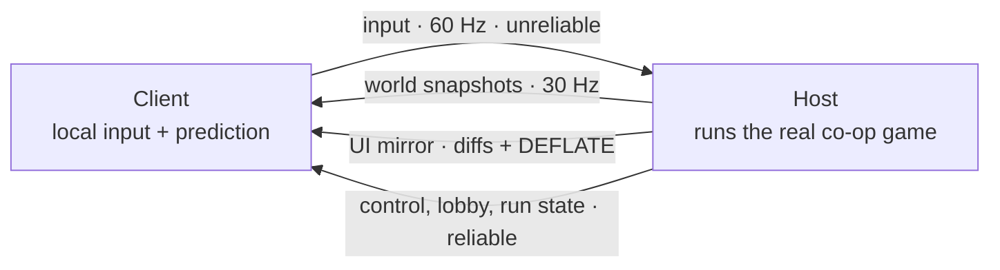

# Brotato Online · Microsoft Store edition

**Online multiplayer mod for the Microsoft Store / Game Pass version of Brotato**, which only ships with local co-op. The host plays a normal co-op run and friends join over the network, each with their own character, shop, upgrades and HUD.

> Unofficial fan project, not affiliated with the game's developers or publishers. This repository contains **only original code**: no game files are included or redistributed.

**Status:** v0.1.1. Full runs are playable between two game instances (menus, character selection, shop, upgrades, waves, HUD, sounds and reconnection). A Windows installer is built from this repo. Testing over the internet between two machines is the next milestone.

## How it works



- **Host-authoritative.** Remote players are registered in the game's own co-op system as virtual gamepads, so all existing co-op logic (scaling, per-player shop, upgrades, revive) is reused instead of reimplemented. The game is not deterministic, so the host is the single source of truth.
- **ENet transport** with separate channels: reliable control messages, unreliable input (latest state wins) and world snapshots.
- **Smooth client:** each client predicts its own movement and renders everything else through an interpolation buffer over the host clock.
- **UI mirror:** instead of streaming video (reading the viewport crashes this engine build), the host describes visible UI controls and sends only what changed, compressed.
- **Resilient sessions:** disconnection detection, retries and a reserved slot so a player can rejoin a run in progress.

## Engineering highlights

- **Reverse engineering the package format.** The Microsoft Store build runs on a custom Godot 3.6 port that ignores `override.cfg` and disables the bundled mod loader. I documented its `.hvp` package format (`docs/hvp_format.md`) and wrote tools to extract and repack it byte for byte, recalculating the index CRC so the game accepts the modified package.
- **Code injection without touching the executable.** The mod is loaded as an autoload added to the boot package. Game behavior is extended through script extensions instead of patching game files.
- **Safe installer for end users.** A small Windows app finds the game on any drive, requires it to be closed, backs up the original package, applies the mod over the user's own copy and can uninstall or reapply it after a game update. The `.exe` contains only original code.
- **Testing without the game.** `tools/check_mod.py` runs a syntax check and a two-process network test with stock Godot 3.6.1. `tools/launch_instances.ps1` starts two game instances on one PC for end-to-end tests.

## Project structure

```
mod/online/
├── net/        ENet transport, protocol and session (handshake, ping, reconnection)
├── input/      Client input capture and host-side input injection
├── sync/       World snapshots, UI mirror, wave viewer and sound sync
├── ui/         In-game lobby panel (F9) and wait overlay
└── util/       Logger
tools/          .hvp extract/pack, mod builder, checks and test launchers (Python, PowerShell)
installer/      Windows installer (tkinter, packaged with PyInstaller)
docs/           Package format, local co-op analysis and online architecture
```

## Stack

Godot 3 · GDScript · ENet · Python (tooling and installer) · PowerShell

## Build

Requires Python 3 and a legally owned copy of Brotato from the Microsoft Store.

Copy your game's `boot.hvp` to `backup/boot.hvp.orig` first: the build always starts from an untouched original.

```bash
python tools/build_mod.py            # builds build/boot_mod.hvp from backup/boot.hvp.orig
python tools/check_mod.py --run 12   # syntax check + 12 s network test with stock Godot 3.6.1
python installer/build_installer.py  # builds dist/BrotatoOnline-Instalador-v<version>.exe
```

In game, press **F9** to open the online panel: host a game or join one by IP and port (default `24565`). Playing over the internet requires port forwarding or a VPN such as Tailscale, ZeroTier or Radmin.

---

Made by [maxxfley](https://github.com/maxxfley).
